# 🔬 02. Đặc Tả Pipeline Xử Lý Ảnh Thuật Toán (Image Processing Pipeline Spec)

## 🎯 Mục Đích
Tài liệu này đặc tả chi tiết toàn bộ chu trình xử lý ảnh từ ảnh chụp thô đến tài liệu scan phẳng, sắc nét và nén file PDF chuẩn in ấn 300 DPI.

---

## 🔄 Toàn Cảnh Pipeline Xử Lý (Processing Stages)

```mermaid
graph LR
    RawInput["📷 Ảnh chụp gốc"] --> Detect["1. Nhận diện 4 góc<br>(Multi-pass Edge)"]
    Detect --> Expand["2. Mở rộng viền 2%<br>(Margin Expansion)"]
    Expand --> Warp["3. Perspective Warp<br>(Nắn vuông góc)"]
    Warp --> Rotate["4. Xoay hướng<br>(0°, 90°, 180°, 270°)"]
    Rotate --> Dewarp["5. Làm phẳng trang<br>(Dewarp Mesh Remap)"]
    Dewarp --> Balance["6. Cân bằng sáng<br>(LAB Space Illumination)"]
    Balance --> Enhance["7. Bộ lọc màu & Nét chữ<br>(Unsharp Masking)"]
    Enhance --> Compress["8. Chuẩn hóa 300 DPI<br>& Nén / Xuất PDF"]
```



---

## 0. Hai Mức Kết Xuất (`core/renderer.py`)

Pipeline được gói trong một hàm thuần duy nhất:

```python
anh_dang_sua = render_page(anh_goc, corners, rotation, settings, max_dim=None)
```

| Mức | `max_dim` | Dùng khi | Thời gian điển hình |
| :--- | :--- | :--- | :--- |
| **Xem trước** | `1600` | Kéo thanh trượt, đổi bộ lọc, kéo góc | **0,1 – 0,3 giây** |
| **Kết xuất đầy đủ** | `None` | Lưu xuống đĩa, xuất PDF, tải ảnh về | 1 – 3 giây |

Ở mức xem trước, ảnh gốc được **thu nhỏ trước** khi vào pipeline và toạ độ 4 góc được nhân theo
đúng tỉ lệ đã thu. Toàn bộ các bước xử lý bên dưới giữ nguyên, chỉ chạy trên ít điểm ảnh hơn.

> **Vì sao tách 2 mức:** trước đây mọi lần nhích thanh trượt đều xử lý ở độ phân giải đầy đủ và
> chặn màn hình bằng lớp phủ, khiến thao tác tinh chỉnh trở nên rất ì. Nay việc nặng chỉ xảy ra
> đúng lúc cần tệp thật.

**Tính xác định:** vì `render_page` là hàm thuần của (ảnh gốc + metadata), tệp trên đĩa luôn có thể
dựng lại chính xác từ `.docscan_meta.json`. Khi lưu, hệ thống dựng lại từ metadata chứ không ghi
lại kết quả xử lý gần nhất còn trong bộ nhớ.

---

## 1. Thuật Toán Nhận Diện 4 Góc Mép Giấy (`core/detector.py`)

### 1.1. Multi-Pass Edge Detection (Nhận Diện Mép Giấy Chuẩn Xác)
1. **Tiền xử lý:**
   - Thu nhỏ kích thước tối đa 1200px để tăng tốc xử lý và loại bỏ nhiễu hạt.
   - Chuyển sang Grayscale và áp dụng bộ lọc `cv2.bilateralFilter(gray, 9, 75, 75)` để làm mượt bề mặt giấy nhưng giữ nguyên đường biên cạnh sắc nét.
2. **Trích xuất cạnh (Canny + Morphological Closing):**
   - Áp dụng `cv2.Canny(blur, 50, 150)`.
   - Giãn và đóng cạnh bằng kernel hình chữ nhật `cv2.morphologyEx(edges, cv2.MORPH_CLOSE, kernel)` để nối liền các đoạn mép giấy bị đứt quãng.
3. **Tìm đa giác 4 đỉnh lớn nhất:**
   - Dùng `cv2.findContours` lấy toàn bộ đường viền.
   - Sắp xếp diện tích từ lớn đến nhỏ, duyệt qua từng contour và xấp xỉ đa giác bằng `cv2.approxPolyDP(cnt, 0.02 * peri, True)`.
   - Nếu tìm thấy đa giác đúng 4 đỉnh với diện tích lớn hơn 15% khung hình -> chấp nhận làm vùng giấy với độ lệch viền chuẩn xác 100% (`margin_percent = 0.0`).
4. **Fallback:** Nếu không tìm được tứ giác thỏa mãn, tự động lấy 4 góc bao trọn ảnh (`margin_percent = 0.0`).

### 1.2. Mở Rộng & Thu Hẹp Viền (Margin Expansion & Shrink - `expand_quad`)
Cho phép người dùng chủ động nới hoặc thu mép cắt:
- Tính trọng tâm tứ giác $C = \frac{1}{4} \sum_{i=0}^3 P_i$.
- Với mỗi đỉnh $P_i$, tịnh tiến theo vector hướng từ tâm:
  - **Mở lề 2% (`expandMargin`):** $P'_i = P_i + 0.02 \cdot (P_i - C)$ giúp đắp thêm viền giấy khi chụp sát mép.
  - **Thu lề 2% (`shrinkMargin`):** $P'_i = P_i - 0.02 \cdot (P_i - C)$ giúp gọt bỏ viền mặt bàn chụp còn sót lại.
- Cắt gọt (clamp) tọa độ nằm trong giới hạn $[0, W]$ và $[0, H]$.

### 1.3. Biến Đổi Phối Cảnh (Perspective Transform - `four_point_transform`)
- Sắp xếp 4 điểm theo thứ tự chuẩn: `[Top-Left, Top-Right, Bottom-Right, Bottom-Left]`.
- Tính chiều rộng và chiều cao tối ưu từ khoảng cách Euclidean giữa các cặp đỉnh.
- Sử dụng `cv2.getPerspectiveTransform` và `cv2.warpPerspective` với nội suy `cv2.INTER_CUBIC` để nắn thẳng tài liệu.

---

## 2. Thuật Toán Làm Phẳng Trang Cong & Nhăn (`core/dewarp.py`)

### 2.1. Phân Tích Độ Cong (Parabolic Cylindrical Model)
- Ảnh sau khi nắn góc nếu có nếp gấp hoặc độ cong (do chụp trang sách mở):
- Hàm `dewarp_page` chia bề mặt thành lưới biến dạng (Deformation Mesh).
- Mô hình hóa đường cong đỉnh và đáy bằng phương trình parabol bậc 2:
  $$y(x) = a \cdot x^2 + b \cdot x + c$$

### 2.2. Lưới Tái Cấu Trúc Điểm Ảnh (`cv2.remap`)
- Tạo ma trận lưới tọa độ $Map_X(x, y)$ và $Map_Y(x, y)$.
- Dùng `cv2.remap` với chế độ nội suy `cv2.INTER_LANCZOS4` để kéo phẳng các dòng chữ bị võng về đường thẳng ngang hoàn hảo.

---

## 3. Bộ Lọc Nâng Cao & Làm Nét Chữ (`core/enhancer.py`)

### 3.1. Cân Bằng Độ Sáng Cục Bộ Trong Không Gian Màu LAB
- Chuyển đổi ảnh sang không gian màu **CIE LAB**:
  - Kênh $L$: Kênh độ sáng (Luminance).
  - Kênh $A, B$: Kênh màu sắc (Chrominance).
- **Khử bóng đổ / bóng tay chụp:**
  - Ước tính bản đồ chiếu sáng nền (Background Illumination Map) bằng cách áp dụng bộ lọc Gaussian lớn:
    $$\text{bg} = \text{GaussianFilter}(L, \sigma = 35)$$
  - Chuẩn hóa kênh sáng:
    $$L_{\text{norm}} = 255 \cdot \frac{L}{\text{bg} + \epsilon}$$
  - Giữ nguyên 100% hai kênh $A$ và $B$ giúp **con dấu đỏ, chữ ký xanh, màu tiêu đề giữ nguyên vẹn không bị lem hay phai màu**.

### 3.2. Làm Sắc Nét Chữ Bằng Unsharp Masking
- Tăng cường độ tương phản ở các biên chữ:
  $$L_{\text{sharp}} = L_{\text{norm}} + \text{strength} \cdot (L_{\text{norm}} - \text{Gaussian}(L_{\text{norm}}, \sigma = 1.5))$$

### 3.3. Bảng Chế Độ Màu & Bộ Lọc (Color Modes)

| Tên chế độ | Key (`mode`) | Mô tả thuật toán |
| :--- | :--- | :--- |
| **Tự nhiên nâng cao (Mặc định)** | `natural` | Cân bằng sáng LAB + Unsharp masking. Giữ 100% màu gốc, chữ đậm nét, nền giấy sáng sạch. |
| **Màu ma thuật (Magic Color)** | `magic_color` | Nền giấy trắng tinh, tăng độ rực rỡ màu mực con dấu/chữ ký và làm nét chữ tối đa. |
| **Nền sạch sáng** | `clean_bg` | Tăng cường làm trắng nền giấy ($L > 220 \to 255$), giữ nguyên độ đậm nét của chữ viết và con dấu màu. |
| **Rõ nét chữ mờ** | `sharp_text` | Nâng tương phản cục bộ với CLAHE (`clipLimit=2.5`), phục hồi chữ viết chì hoặc mực nhạt. |
| **Trắng đen rõ nét** | `bw_scan` | Phân ngưỡng thích nghi Otsu/Adaptive Thresholding, tạo bản scan đơn sắc nhị phân hoàn hảo cho in ấn. |
| **Làm nổi Dấu & Chữ ký** | `high_contrast_stamp` | Tăng bão hòa sắc tố đỏ/xanh trong không gian HSV, tôn vinh con dấu mộc và chữ ký. |
| **Phục hồi giấy ố vàng** | `restore_yellowed` | Khử sắc vàng trên kênh $B$ của không gian LAB, biến nền giấy cũ thành trắng tinh. |
| **Khử thấu quang mặt sau** | `remove_bleedthrough` | Nhận diện nét mực mờ từ trang sau bằng phân tích histogram và triệt tiêu. |
| **Hóa đơn nhiệt & Giấy than** | `super_sharp_mono` | Xử lý tăng cường tương phản cao phục hồi chữ mờ hóa đơn tính tiền, biên lai siêu thị. |
| **Ảnh gốc cắt phẳng** | `original` | Giữ nguyên màu sắc và độ sáng của ảnh chụp ban đầu, chỉ áp dụng cắt 4 góc và xoay. |

---

## 4. Chuẩn Hóa 300 DPI, Nén & Xuất PDF (`core/compressor.py`)

1. **Chuẩn hóa độ phân giải in ấn (300 DPI):**
   - Với ảnh chụp độ phân giải quá cao (4K/8K > 4000px): Thu nhỏ thông minh theo tỉ lệ khổ A4 chuẩn in (2480 x 3508 pixels tại 300 DPI) giúp giảm 70-85% dung lượng mà độ nét in không đổi.
2. **Nén JPEG chất lượng cao:**
   - Tối ưu bảng Huffman và chất lượng JPEG 85% (`cv2.IMWRITE_JPEG_QUALITY, 85`).
3. **Ghép tập tin PDF nhiều trang & Bảo Toàn Tỷ Lệ (Aspect Ratio Preservation):**
   - Sử dụng thư viện `fitz` (PyMuPDF) để tạo trang PDF chuẩn kích thước ảnh, gắn nén trực tiếp luồng stream nhị phân.
   - Tự động tính toán khung vẽ căn giữa trang (`offset_x`, `offset_y`) và giữ nguyên tỷ lệ khung hình (`keep_proportion=True`), tuyệt đối không làm méo hay biến dạng tài liệu khi xuất PDF.
4. **Đóng gói tệp ZIP tải ảnh hàng loạt (`create_images_zip`):**
   - Đóng gói toàn bộ hoặc danh sách trang được chọn thành tệp `.zip` với tên tệp tiếng Việt giữ nguyên dấu, phục vụ tải về 1-click tiện lợi.
