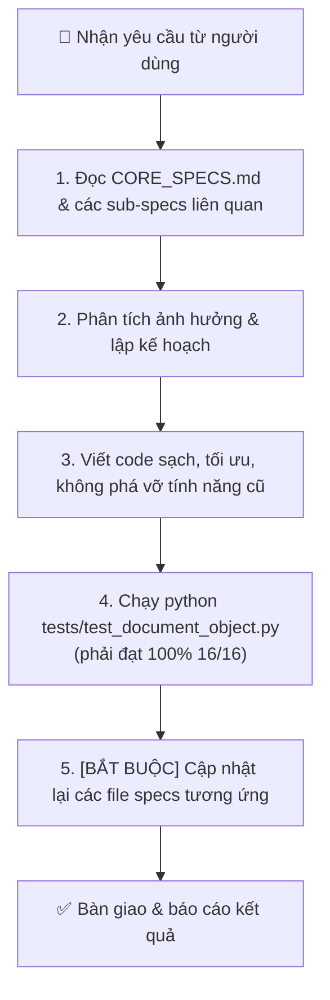

# 📜 06. Quy Chuẩn Đồng Bộ & Bảo Trì Code - Specs (Developer & AI Guidelines)

## 🎯 Mục Đích
Tài liệu này là **bản hợp đồng bắt buộc (Strict Contract)** dành cho mọi kỹ sư phần mềm và các trợ lý AI khi tiếp nhận, mở rộng, sửa lỗi hoặc tái cấu trúc (refactor) codebase `refine_docs`.

---

## 🚦 Quy Trình Bắt Buộc Khi Thực Hiện Mọi Tác Vụ (Standard Operating Procedure)



---

## 🧪 Bộ Kiểm Thử Bất Biến (`tests/test_document_object.py`)

```bash
python tests/test_document_object.py
```

16 bài kiểm thử chạy trên thư mục dự án tạm, khóa lại đúng những lỗi đã từng làm hỏng dữ liệu:

| Nhóm | Bảo vệ điều gì |
| :--- | :--- |
| **Bộ ba trọn vẹn** | Ảnh vừa nhập có đủ ảnh gốc + ảnh sửa + metadata; tên giữ dấu tiếng Việt; nhập trùng tên không ghi đè |
| **Đổi tên** | Đổi cả 3 thành phần, không để lại bản sao, giữ nguyên vị trí trong thứ tự in |
| **Metadata** | Payload lưu thiếu trường không xóa trắng góc cắt / bộ lọc / lịch sử; tra cứu không phân biệt hoa thường |
| **Tệp PDF & ZIP** | Tự động lưu 1 trang không làm tệp PDF co lại; xuất ZIP/PDF chuẩn theo danh sách chọn |
| **Đồng bộ ảnh ↔ metadata** | Phát hiện ảnh trên đĩa cũ hơn metadata và khôi phục được |
| **Vòng đời trang** | Nhận nuôi ảnh lẻ không tự cắt ảnh sẵn có; chuyển / xóa trang tác động đủ cả 3 phần |
| **An toàn** | Định danh trang tất định; tự động gộp kho chưa duyệt trùng lặp; chặn đường dẫn thoát ra ngoài thư mục dự án |

---

## 📋 Checklist Kiểm Tra Tính Đồng Bộ (Sync Checklist)

Trước khi hoàn tất bất kỳ tác vụ nào, phải kiểm tra các tiêu chí sau:

- [ ] **Specs 1:1 Sync:** Tính năng mới, thay đổi API hoặc sửa đổi giao diện đã được ghi nhận chi tiết vào tài liệu specs tương ứng trong `docs/specs/` chưa?
- [ ] **Global Rule Check:** Có vô tình để lộ UUIDs, DB IDs, stack traces, raw error codes lên giao diện người dùng không? (100% dùng Custom Modals).
- [ ] **Ảnh gốc an toàn:** Có đảm bảo thư mục `_goc/` không bị xóa nhầm hay ghi đè tự ý không?
- [ ] **Lịch sử Undo/Redo:** Tính năng mới có duy trì khả năng hoàn tác và lưu vào `.docscan_meta.json` không?
- [ ] **Trạng thái lưu:** Nút `[ 💾 Lưu thay đổi ]` đã phản ánh đúng `dirtyPages.size > 0` chưa?
- [ ] **Kiểm thử hợp lệ:** Đã chạy `python tests/test_document_object.py` và **đạt trọn vẹn 16/16 test** chưa?
- [ ] **Bộ ba không lệch:** Mọi thao tác ghi tệp của một trang đều đi qua `core/pagestore.py`.

---

## 🛠️ Quy Định Về Mã Nguồn (Code Quality Standards)

1. **Backend (`Python` / `FastAPI`):**
   - Viết type hints đầy đủ (`Pydantic BaseModel`, `Optional`, `List`).
   - Xử lý ngoại lệ rõ ràng với `HTTPException(status_code=..., detail="Thông báo tiếng Việt dễ hiểu")`.
   - Giữ các hàm xử lý ảnh trong `core/` độc lập, có thể kiểm thử đơn vị độc lập mà không cần khởi động server.
2. **Frontend (`JavaScript ES6+` / `CSS3`):**
   - Không sử dụng các framework nặng; duy trì kiến trúc Vanilla JS module hóa, gọn nhẹ, mở tức thì.
   - Giao diện tuân thủ bảng màu Apple-Dark theme sang trọng.
   - Mọi thao tác async phải có `try/catch` và thông báo Toast tiếng Việt thân thiện.