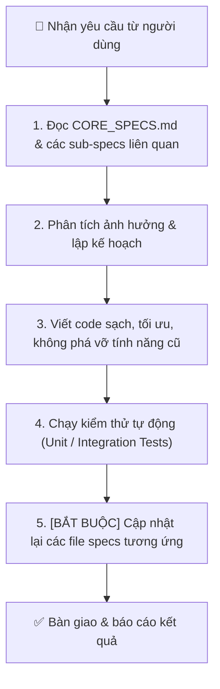

# 📜 06. Quy Chuẩn Đồng Bộ & Bảo Trì Code - Specs (Developer & AI Guidelines)

## 🎯 Mục Đích
Tài liệu này là **bản hợp đồng bắt buộc (Strict Contract)** dành cho mọi kỹ sư phần mềm và các trợ lý AI (như Antigravity / Claude / GPT) khi tiếp nhận, mở rộng, sửa lỗi hoặc tái cấu trúc (refactor) codebase `refine_docs`.

---

## 🚦 Quy Trình Bắt Buộc Khi Thực Hiện Mọi Tác Vụ (Standard Operating Procedure)

---

## 📋 Checklist Kiểm Tra Tính Đồng Bộ (Sync Checklist)

Trước khi hoàn tất bất kỳ tác vụ nào, phải kiểm tra các tiêu chí sau:

- [ ] **Specs 1:1 Sync:** Tính năng mới, thay đổi API hoặc sửa đổi giao diện đã được ghi nhận chi tiết vào tài liệu specs tương ứng trong `docs/specs/` chưa?
- [ ] **Global Rule Check:** Có vô tình để lộ UUIDs, DB IDs (ví dụ: `prof-178...`), stack traces, raw error codes lên giao diện người dùng không?
- [ ] **Ảnh gốc an toàn:** Có đảm bảo thư mục `_goc/` không bị xóa nhầm hay ghi đè tự ý không?
- [ ] **Lịch sử Undo/Redo:** Tính năng mới có duy trì khả năng hoàn tác và lưu vào `.docscan_meta.json` không?
- [ ] **Auto-save:** Các tương tác chỉnh sửa có được gắn kích hoạt `scheduleAutoSave(60000)` không?
- [ ] **Kiểm thử hợp lệ:** Tất cả các endpoint API mới có vượt qua bài test của FastAPI TestClient không?

---

## 🛠️ Quy Định Về Mã Nguồn (Code Quality Standards)

1. **Backend (`Python` / `FastAPI`):**
   - Viết type hints đầy đủ (`Pydantic BaseModel`, `Optional`, `List`).
   - Xử lý ngoại lệ rõ ràng với `HTTPException(status_code=..., detail="Thông báo tiếng Việt dễ hiểu")`.
   - Giữ các hàm xử lý ảnh trong `core/` độc lập, có thể kiểm thử đơn vị độc lập mà không cần khởi động server.
2. **Frontend (`JavaScript ES6+` / `CSS3`):**
   - Không sử dụng các framework nặng (React/Vue/Angular) nếu không có yêu cầu rõ ràng; duy trì kiến trúc Vanilla JS module hóa, gọn nhẹ, mở tức thì.
   - Giao diện tuân thủ bảng màu Apple-Dark theme sang trọng (`#0b1120`, `#0f172a`, `#38bdf8`, `#10b981`, `#f59e0b`, `#ef4444`).
   - Mọi thao tác async phải có `try/catch` và thông báo Toast tiếng Việt thân thiện.
