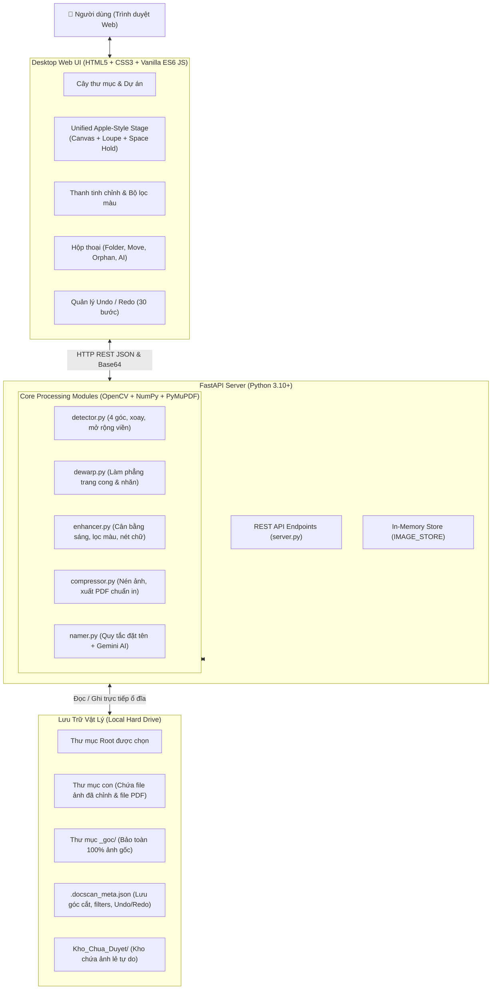

# 📖 DocScan Studio - Core Specification (CORE_SPECS)

> **MỤC TIÊU CỐT LÕI (CORE MISSION):**
> DocScan Studio là ứng dụng Desktop Web chuyên nghiệp dùng để quét, nắn thẳng, làm phẳng trang sách/tài liệu nhăn, làm sắc nét chữ và tổ chức tài liệu nhiều trang xuất file PDF chuẩn in ấn chất lượng cao.
> 
> **QUY TẮC BẮT BUỘC DÀNH CHO MỌI AI ASSISTANT / DEVELOPER:**
> 1. **Khởi đầu từ tài liệu này:** Mọi tác vụ phân tích, nâng cấp, sửa lỗi hoặc tái cấu trúc (refactor) **BẮT BUỘC** phải đọc và tuân thủ các tài liệu specs trong thư mục `docs/specs/`.
> 2. **Đồng bộ 1:1 giữa Code và Specs:** Khi thêm tính năng mới (`NEW`), nâng cấp (`IMPROVE`), hoặc thay đổi logic (`CHANGE`), **BẮT BUỘC** phải cập nhật lại tài liệu specs tương ứng ngay trong cùng phiên làm việc.
> 3. **Tuyệt đối tuân thủ Global Rule:** Không bao giờ hiển thị thông tin kỹ thuật nội bộ (UUIDs, raw DB IDs, stack traces, internal codes) lên giao diện người dùng (UI). Luôn sử dụng ngôn ngữ tiếng Việt thân thiện, rõ ràng.

---

## 🗺️ Bản Đồ Tài Liệu Kỹ Thuật (Specs Map)

Để hiểu sâu từng module và phát triển không bị mơ hồ, hãy xem các tài liệu chuyên biệt dưới đây:

| STT | Tài liệu chi tiết | Nội dung chính |
| :--- | :--- | :--- |
| **01** | [**01. Lưu Trữ & Hệ Thống Tệp Tin**](file:///d:/Hoa%20Hoang/Apps/refine_docs/docs/specs/01_STORAGE_AND_FILE_SYSTEM.md) | Cấu trúc đĩa vật lý, thư mục `_goc/`, metadata `.docscan_meta.json`, `Kho_Chua_Duyet`, Auto-save 60s, xử lý ảnh lẻ (Orphan Images). |
| **02** | [**02. Pipeline Xử Lý Ảnh Thuật Toán**](file:///d:/Hoa%20Hoang/Apps/refine_docs/docs/specs/02_IMAGE_PROCESSING_PIPELINE.md) | Nhận diện 4 góc, Perspective Transform, Margin Expansion, Làm phẳng Dewarp, 5+ bộ lọc màu, làm nét chữ, nén & xuất PDF. |
| **03** | [**03. Giao Diện & Trải Nghiệm Người Dùng (UI/UX)**](file:///d:/Hoa%20Hoang/Apps/refine_docs/docs/specs/03_UI_UX_AND_INTERACTION.md) | Viewport đơn kiểu Apple, Hold-to-Compare (Phím Space), Kính lúp Loupe 2.5x, Kéo chỉnh 4 góc, Cây thư mục điều chỉnh kích thước, Undo/Redo. |
| **04** | [**04. Đặc Tả Giao Tiếp API (Backend API Spec)**](file:///d:/Hoa%20Hoang/Apps/refine_docs/docs/specs/04_API_SPECIFICATION.md) | Toàn bộ REST APIs của FastAPI: schemas dữ liệu, request/response models, mã trạng thái HTTP, xử lý lỗi. |
| **05** | [**05. Đặt Tên Tài Liệu & Gợi Ý AI On-Demand**](file:///d:/Hoa%20Hoang/Apps/refine_docs/docs/specs/05_NAMING_AND_AI_SUGGESTIONS.md) | Thuật toán sinh slug tên chuẩn, tích hợp Gemini AI nhận diện ngữ cảnh, chính sách tiết kiệm token (chỉ chạy khi user bấm). |
| **06** | [**06. Hướng Dẫn Đồng Bộ & Bảo Trì Code - Specs**](file:///d:/Hoa%20Hoang/Apps/refine_docs/docs/specs/06_DEVELOPER_AND_AI_SYNC_GUIDELINES.md) | Quy trình chuẩn khi commit, checklist kiểm tra tính toàn vẹn, nguyên tắc viết code sạch và chống lệch specs. |

---

## 🏗️ Kiến Trúc Tổng Quan Ứng Dụng (High-Level Architecture)



---

## 📂 Cấu Trúc Thư Mục Dự Án (Project Layout)

```
refine_docs/
├── core/                           # Thư viện thuật toán lõi xử lý ảnh
│   ├── __init__.py
│   ├── detector.py                 # Nhận diện 4 góc mép giấy & perspective warp
│   ├── dewarp.py                   # Thuật toán làm phẳng cong võng & nếp gấp
│   ├── enhancer.py                 # Bộ lọc nâng cao: cân bằng sáng LAB, làm nét chữ
│   ├── compressor.py               # Chuẩn hóa 300 DPI, nén JPEG, ghép PDF
│   └── namer.py                    # Sinh tên tài liệu cơ bản & gọi Gemini AI
├── docs/                           # Thư mục tài liệu & đặc tả kỹ thuật
│   └── specs/                      # Bộ đặc tả chi tiết 1:1 với code
│       ├── CORE_SPECS.md           # Entrypoint đặc tả trung tâm (Tài liệu này)
│       ├── 01_STORAGE_AND_FILE_SYSTEM.md
│       ├── 02_IMAGE_PROCESSING_PIPELINE.md
│       ├── 03_UI_UX_AND_INTERACTION.md
│       ├── 04_API_SPECIFICATION.md
│       ├── 05_NAMING_AND_AI_SUGGESTIONS.md
│       └── 06_DEVELOPER_AND_AI_SYNC_GUIDELINES.md
├── static/                         # Giao diện người dùng Desktop Web
│   ├── css/
│   │   └── style.css               # Apple-dark theme, flexbox/grid, modal, canvas controls
│   ├── js/
│   │   └── app.js                  # Frontend Controller: State, Event Listeners, Canvas rendering
│   └── index.html                  # Cấu trúc HTML giao diện ứng dụng
├── main.py                         # Điểm chạy ứng dụng Desktop (khởi động server + tự mở browser)
├── server.py                       # FastAPI backend server & API routing
├── requirements.txt                # Danh sách thư viện Python phụ thuộc
├── run.bat                         # Shortcut nhấp đúp chạy ứng dụng trên Windows
└── README.md                       # Giới thiệu tổng quan nhanh
```

---

## ⚙️ Các Bất Biến Kỹ Thuật Bắt Buộc (System Invariants)

1. **Bảo toàn ảnh gốc tuyệt đối:** Ảnh gốc không bao giờ bị ghi đè ngầm, luôn được cất giữ an toàn trong thư mục con `_goc/` hoặc được nâng cấp thành ảnh gốc mới khi người dùng bấm nút xác nhận rõ ràng (`Lưu làm ảnh gốc mới`).
2. **Khả năng làm việc Offline hoàn toàn:** Ứng dụng chạy offline 100% với OpenCV và NumPy. Tính năng AI đặt tên qua Gemini là **tùy chọn (on-demand)** và chỉ kích hoạt khi người dùng chủ động bấm yêu cầu.
3. **Persistent State across Restarts:** Tọa độ 4 góc, góc xoay, các thanh trượt bộ lọc và lịch sử Undo/Redo của từng trang được lưu vào `.docscan_meta.json`. Khi mở lại app, người dùng có thể tiếp tục `Ctrl + Z` hoàn tác như chưa từng tắt app.
4. **Auto-Save 60 giây an toàn:** Khi có chỉnh sửa mà người dùng quên bấm lưu, hệ thống tự động lưu sau 60 giây không thao tác.
5. **Tạo thư mục thực tức thì:** Thao tác tạo/đổi tên/xóa thư mục trên giao diện luôn gọi API tạo/sửa/xóa trực tiếp trên ổ cứng máy tính ngay lập tức.
