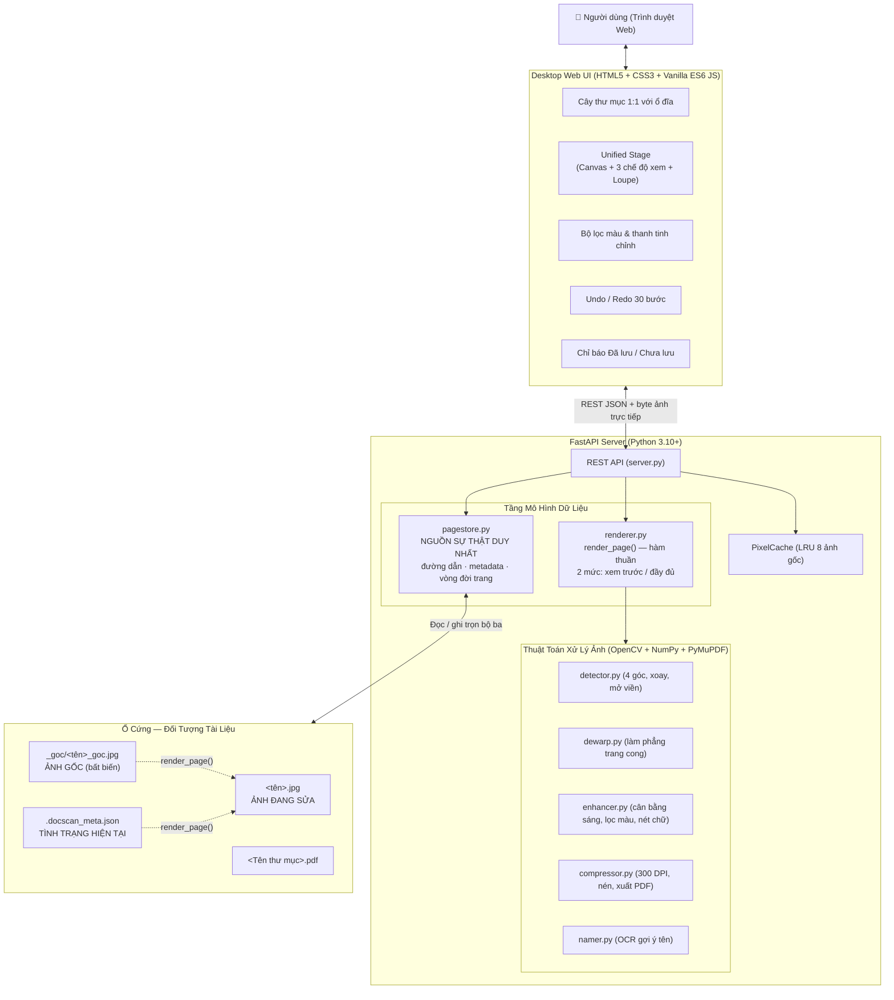

# 📖 DocScan Studio - Core Specification (CORE_SPECS)

> **MỤC TIÊU CỐT LÕI (CORE MISSION):**
> DocScan Studio là ứng dụng Desktop Web chuyên nghiệp dùng để quét, nắn thẳng, làm phẳng trang sách/tài liệu nhăn, làm sắc nét chữ và tổ chức tài liệu nhiều trang xuất file PDF chuẩn in ấn chất lượng cao.
> 
> **QUY TẮC BẮT BUỘC DÀNH CHO MỌI AI ASSISTANT / DEVELOPER:**
> 1. **Khởi đầu từ tài liệu này:** Mọi tác vụ phân tích, nâng cấp, sửa lỗi hoặc tái cấu trúc (refactor) **BẮT BUỘC** phải đọc và tuân thủ các tài liệu specs trong thư mục `docs/specs/`.
> 2. **Đồng bộ 1:1 giữa Code và Specs:** Khi thêm tính năng mới (`NEW`), nâng cấp (`IMPROVE`), hoặc thay đổi logic (`CHANGE`), **BẮT BUỘC** phải cập nhật lại tài liệu specs tương ứng ngay trong cùng phiên làm việc.
> 3. **Tuyệt đối tuân thủ Global Rule:** Không bao giờ hiển thị thông tin kỹ thuật nội bộ (UUIDs, raw DB IDs, stack traces, internal codes) lên giao diện người dùng (UI). Luôn sử dụng ngôn ngữ tiếng Việt thân thiện, rõ ràng.

---

## 🗺️ Bản Đồ Tài Liệu Kỹ Thuật (Specs Map)

Để hiểu sâu từng module và phát triển không bị mơ hồ, hãy xem các tài liệu chuyên biệt dưới đây:

| STT | Tài liệu chi tiết | Nội dung chính |
| :--- | :--- | :--- |
| **01** | [**01. Lưu Trữ & Hệ Thống Tệp Tin**](file:///d:/Hoa%20Hoang/Apps/refine_docs/docs/specs/01_STORAGE_AND_FILE_SYSTEM.md) | **Bất biến đối tượng tài liệu (bộ ba gốc/sửa/metadata)**, cấu trúc đĩa, `_goc/`, ghi metadata hợp nhất, thứ tự trang, quét nhẹ, 3 mức lưu, ảnh lẻ, `Kho_Chua_Duyet`. |
| **02** | [**02. Pipeline Xử Lý Ảnh Thuật Toán**](file:///d:/Hoa%20Hoang/Apps/refine_docs/docs/specs/02_IMAGE_PROCESSING_PIPELINE.md) | **Hai mức kết xuất (xem trước 1600px / đầy đủ)**, nhận diện 4 góc, Perspective Transform, mở viền, Dewarp, 10 bộ lọc màu, nén & xuất PDF. |
| **03** | [**03. Giao Diện & Trải Nghiệm Người Dùng (UI/UX)**](file:///d:/Hoa%20Hoang/Apps/refine_docs/docs/specs/03_UI_UX_AND_INTERACTION.md) | **4 nguyên tắc trải nghiệm**, bộ chuyển 3 chế độ xem, so sánh trước/sau trung thực, kính lúp 2.5x, kéo 4 góc, chỉ báo đã lưu, Undo/Redo, bố cục co giãn. |
| **04** | [**04. Đặc Tả Giao Tiếp API (Backend API Spec)**](file:///d:/Hoa%20Hoang/Apps/refine_docs/docs/specs/04_API_SPECIFICATION.md) | Toàn bộ REST API: định danh trang theo `(thư mục, tên tệp)`, bản ghi trang chuẩn, request/response, mã HTTP, quy ước lỗi tiếng Việt. |
| **05** | [**05. Đặt Tên Tài Liệu & Gợi Ý AI On-Demand**](file:///d:/Hoa%20Hoang/Apps/refine_docs/docs/specs/05_NAMING_AND_AI_SUGGESTIONS.md) | Tên hiển thị = tên tệp trên đĩa, **giữ nguyên dấu tiếng Việt**, chống trùng tên, gợi ý tên bằng OCR chỉ chạy khi người dùng bấm. |
| **06** | [**06. Hướng Dẫn Đồng Bộ & Bảo Trì Code - Specs**](file:///d:/Hoa%20Hoang/Apps/refine_docs/docs/specs/06_DEVELOPER_AND_AI_SYNC_GUIDELINES.md) | Quy trình chuẩn khi commit, checklist kiểm tra tính toàn vẹn, nguyên tắc viết code sạch và chống lệch specs. |

---

## 🏗️ Kiến Trúc Tổng Quan Ứng Dụng (High-Level Architecture)



---

## 📂 Cấu Trúc Thư Mục Dự Án (Project Layout)

```
refine_docs/
├── core/                           # Thư viện lõi
│   ├── __init__.py
│   ├── pagestore.py                # ★ NGUỒN SỰ THẬT: đối tượng tài liệu, đường dẫn, metadata
│   ├── renderer.py                 # ★ Bộ dựng ảnh xác định (xem trước / đầy đủ)
│   ├── detector.py                 # Nhận diện 4 góc & perspective warp
│   ├── dewarp.py                   # Làm phẳng trang cong võng
│   ├── enhancer.py                 # Bộ lọc màu, cân bằng sáng, làm nét chữ
│   ├── compressor.py               # Chuẩn hóa 300 DPI, nén JPEG, ghép PDF
│   └── namer.py                    # Sinh tên cơ bản & gợi ý tên bằng OCR
├── docs/specs/                     # Bộ đặc tả chi tiết 1:1 với code
│   ├── CORE_SPECS.md               # Tài liệu này
│   ├── 01_STORAGE_AND_FILE_SYSTEM.md
│   ├── 02_IMAGE_PROCESSING_PIPELINE.md
│   ├── 03_UI_UX_AND_INTERACTION.md
│   ├── 04_API_SPECIFICATION.md
│   ├── 05_NAMING_AND_AI_SUGGESTIONS.md
│   └── 06_DEVELOPER_AND_AI_SYNC_GUIDELINES.md
├── static/
│   ├── css/style.css               # Apple-dark theme, bố cục co giãn
│   ├── js/app.js                   # Frontend Controller
│   └── index.html
├── main.py                         # Chạy ứng dụng (khởi động server + mở trình duyệt)
├── server.py                       # FastAPI backend & định tuyến API
├── requirements.txt
├── run.bat
└── README.md
```

---

## ⚙️ Các Bất Biến Kỹ Thuật Bắt Buộc (System Invariants)

1. **Đối tượng tài liệu là bộ ba không tách rời.** Mỗi trang luôn gồm đủ ảnh gốc `_goc/<tên>_goc.jpg`,
   ảnh đang sửa `<tên>.jpg` và mục metadata trong `.docscan_meta.json`. Mọi thao tác vòng đời
   (nhập, đổi tên, di chuyển, xóa) tác động **đồng thời lên cả ba**, không bao giờ để lệch.
   → Toàn bộ quy tắc nằm ở `core/pagestore.py`; không code nào khác được tự ghép đường dẫn hay ghi tệp.

2. **Bảo toàn ảnh gốc tuyệt đối.** Ảnh gốc không bao giờ bị ghi đè ngầm; chỉ thay thế khi người dùng
   bấm xác nhận rõ ràng (`Lưu ảnh sửa thành ảnh gốc`).

3. **Ảnh đang sửa là hàm thuần của metadata:** `render(ảnh_gốc, corners, rotation, settings)`.
   Khi lưu, hệ thống dựng lại từ metadata rồi mới ghi đè — tệp trên đĩa luôn khớp thứ metadata mô tả.

4. **Ghi metadata hợp nhất theo từng trường & tra cứu an toàn.** Trường vắng mặt hoặc `null` giữ nguyên
   giá trị cũ. Tra cứu metadata `find_meta_entry()` an toàn không phân biệt hoa thường trên Windows.

5. **Bắt đầu từ thư mục nào cũng như nhau.** Ảnh vừa nhập được ghi đủ bộ ba xuống đĩa ngay lập tức;
   không tồn tại "trang chỉ nằm trong RAM". Đóng app đột ngột không mất dữ liệu.

6. **Quét nhẹ, tải ảnh theo yêu cầu.** `scan-directory` không nạp điểm ảnh và không trả base64;
   ảnh đi qua `GET /api/image` để trình duyệt tự đệm. Bộ nhớ máy chủ giới hạn bằng LRU 8 ảnh.

7. **Offline 100% & AI On-Demand.** Toàn bộ xử lý chạy cục bộ bằng OpenCV/NumPy. Gợi ý tên bằng AI/OCR là **tùy chọn**
   duy nhất tại ô nhập tên và chỉ chạy khi người dùng chủ động bấm `[ ✨ AI gợi ý tên ]`.

8. **Trạng thái bền vững qua các phiên.** 4 góc, góc xoay, bộ lọc, thứ tự trang và ngăn xếp Undo/Redo
   được lưu vào `.docscan_meta.json`. Mở lại app vẫn `Ctrl + Z` hoàn tác được như chưa từng tắt.

9. **Lưu thay đổi chính xác:** Nút `[ 💾 Lưu thay đổi ]` chỉ sáng khi có trang chỉnh sửa dở (`dirtyPages > 0`),
   tự động mờ khi dữ liệu an toàn.

10. **Thao tác thư mục tức thì & chặn thoát an toàn.** Tự động gộp Kho ảnh chưa duyệt trùng lặp,
    chặn mọi đường dẫn thoát ra ngoài thư mục dự án.

11. **Không lộ thông tin kỹ thuật ra giao diện.** 100% dùng hộp thoại xác nhận tùy biến (Custom Modal),
    không UUID, không mã lỗi tiếng Anh, không stack trace — chỉ tên tệp rõ ràng và câu tiếng Việt dễ hiểu.

12. **Ghi đĩa thất bại phải báo lỗi.** Không thao tác lưu nào được trả "thành công" khi chưa ghi được
    byte nào. Giao diện chỉ xoá cờ "chưa lưu" cho đúng những trang máy chủ xác nhận đã ghi
    (`saved_filenames`); trang ghi hỏng giữ nguyên cờ để người dùng thử lại.

13. **Không ảnh nào được biến mất khỏi giao diện.** Mọi trang trả về phải thuộc một thư mục có trong
    cây. Thư mục trùng lặp được gộp thật và chỉ xoá khi đã rỗng; gộp hỏng thì hiển thị cả hai
    kèm cảnh báo, tuyệt đối không giấu bớt dữ liệu người dùng.

14. **Việc nặng không chạy trên event loop.** Endpoint nặng CPU khai báo `def` thường để FastAPI đẩy
    sang threadpool. Nếu để `async def`, một lần lưu sẽ đóng băng mọi thao tác khác của người dùng.

15. **Không bật CORS.** Giao diện cùng nguồn nên không cần; mở `allow_origins=["*"]` trên máy chủ
    nội bộ là để lộ toàn bộ tài liệu đã quét cho bất kỳ website nào người dùng đang mở.

16. **Có giới hạn tài nguyên đầu vào.** Ảnh nhập vào bị chặn theo dung lượng (80 MB) và độ phân giải
    (80 MP) để một tệp bất thường không làm cạn RAM và treo ứng dụng.

17. **PDF và ảnh xuất ra là việc của người dùng.** Lưu = ghi ảnh + metadata, không bao giờ tự
    ghép PDF. Mọi lệnh xuất đều hỏi nơi lưu trước (mặc định là thư mục tài liệu đang mở), và chỉ
    ghi vào đường dẫn do chính hộp thoại hệ điều hành cấp.

18. **Chỉ lưu thứ đã thay đổi.** `[ 💾 Lưu thay đổi ]` chỉ gửi các trang trong `dirtyPages`; kết xuất
    lại toàn bộ dự án hàng trăm trang sẽ treo máy hàng phút mà không đổi gì.
